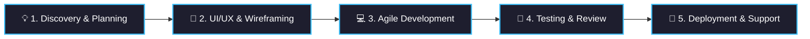

<div align="center">
  <!-- Custom Profile Banner -->
  

  <br/><br/>

  <!-- Dynamic Typing SVG -->
  <a href="https://github.com/krishanprageeth0">
    
  </a>

  <br/><br/>

  <!-- Profile Visitor Counter & Quick Status Badges -->
  <p align="center">
    
    
    
  </p>

  <!-- Connect & Client Action Buttons -->
  <p align="center">
    <a href="https://krishanprageeth0.github.io/portfolioknexa/" target="_blank">
      
    </a>
    <a href="mailto:Krishanprageeth87@gmail.com">
      
    </a>
    <a href="https://linkedin.com/in/krishanprageeth" target="_blank">
      
    </a>
    <a href="https://wa.me/?text=Hi%20Krishan,%20I'd%20like%20to%20discuss%20a%20project!" target="_blank">
      
    </a>
  </p>
</div>

---

### 🏆 GitHub Achievements & Trophies

<div align="center">
  <a href="https://github.com/krishanprageeth0">
    
  </a>
</div>

---

### 👨‍💻 About Me & What Drives Me

I am a results-driven **Associate Software Engineer** and **Full-Stack Developer** committed to turning ideas into clean, scalable web apps and high-performance digital solutions. With hands-on expertise spanning modern frontend frameworks, scalable cloud architectures, and robust backend engineering, I help businesses and clients build exceptional web products.

```yaml
Developer Profile:
  Name: Krishan Prageeth
  Role: Associate Software Engineer
  Tagline: "Code. Learn. Build. Repeat. </> | Turning ideas into clean, scalable web apps"
  Core Stack: React.js, Next.js, Node.js, MongoDB, TypeScript, AWS, Docker
  Architecture: Clean Architecture | Git Flow | Agile Delivery | Cloud Ready
  Availability: Freelance Collaborations, Remote Roles & Engineering Opportunities
  Direct Contact: Krishanprageeth87@gmail.com
```

---

### 💼 Services I Deliver (Why Clients Choose Me)

<table>
  <tr>
    <td width="50%">
      <h4>🌐 Full-Stack Web Development</h4>
      <p>Custom, scalable web platforms built with <b>React, Next.js, and Node.js</b>. Clean code structure, mobile responsiveness, and ultra-fast load times.</p>
    </td>
    <td width="50%">
      <h4>🛍️ WordPress & E-Commerce Solutions</h4>
      <p>Tailor-made WordPress & WooCommerce stores, custom theme styling, seamless payment gateway integrations, and speed optimization.</p>
    </td>
  </tr>
  <tr>
    <td width="50%">
      <h4>🎨 UI/UX to Pixel-Perfect Code</h4>
      <p>Accurate translation of <b>Figma / Adobe XD</b> designs into responsive, modern Tailwind CSS or styled components with smooth micro-interactions.</p>
    </td>
    <td width="50%">
      <h4>⚡ API & AI Integrations</h4>
      <p>Robust RESTful API design, database modeling (SQL / NoSQL), third-party SaaS integrations, and modern AI capability workflows.</p>
    </td>
  </tr>
</table>

---

### 🔄 My Client Collaboration Process



---

### 🛠️ Tech Stack & Capabilities

<div align="center">

#### 💻 Frontend Engineering & Languages
<a href="https://skillicons.dev">
  
</a>

<br/>

#### ⚙️ Backend, Databases & CMS
<a href="https://skillicons.dev">
  
</a>

<br/>

#### 🧰 Tools, Cloud & DevOps
<a href="https://skillicons.dev">
  
</a>

</div>

---

### 🚀 Featured Client & Showcase Projects

<table>
  <tr>
    <td width="50%" valign="top">
      <h3 align="center">💼 Portfolio Knexa</h3>
      <p align="center">Modern agency & developer portfolio featuring clean aesthetic architecture, smooth animations, and interactive project showcases.</p>
      <p align="center">
        <b>Tech Stack:</b> <code>HTML5</code> <code>CSS3</code> <code>JavaScript</code> <code>UI/UX</code>
      </p>
      <p align="center">
        <a href="https://krishanprageeth0.github.io/portfolioknexa/" target="_blank">🌐 <b>Live Demo</b></a> &nbsp;•&nbsp; 
        <a href="https://github.com/krishanprageeth0/portfolioknexa" target="_blank">💻 <b>Source Code</b></a>
      </p>
    </td>
    <td width="50%" valign="top">
      <h3 align="center">✈️ Aether Travels</h3>
      <p align="center">An immersive tourism & travel discovery hub built with intuitive tour package showcases, responsive layouts, and booking inquiry workflows.</p>
      <p align="center">
        <b>Tech Stack:</b> <code>HTML5</code> <code>CSS3</code> <code>JavaScript</code> <code>Mobile-First</code>
      </p>
      <p align="center">
        <a href="https://github.com/krishanprageeth0/AETHER-TRAVELS" target="_blank">💻 <b>GitHub Repository</b></a>
      </p>
    </td>
  </tr>
  <tr>
    <td width="50%" valign="top">
      <h3 align="center">💍 Knexa Digital Invitations</h3>
      <p align="center">Modern interactive digital wedding invitation web app with dynamic typography, responsive layouts, and elegant RSVP flows.</p>
      <p align="center">
        <b>Tech Stack:</b> <code>TypeScript</code> <code>HTML5</code> <code>CSS3</code> <code>Modern UX</code>
      </p>
      <p align="center">
        <a href="https://github.com/krishanprageeth0/wedding-invitation-knexa" target="_blank">💻 <b>GitHub Repository</b></a>
      </p>
    </td>
    <td width="50%" valign="top">
      <h3 align="center">🎨 Atelier Sens</h3>
      <p align="center">An elegant styling and creative brand showcase platform emphasizing minimalist layout systems and cross-device responsiveness.</p>
      <p align="center">
        <b>Tech Stack:</b> <code>CSS3 Grid/Flex</code> <code>Responsive Design</code>
      </p>
      <p align="center">
        <a href="https://github.com/krishanprageeth0/ATELIER-SENS" target="_blank">💻 <b>GitHub Repository</b></a>
      </p>
    </td>
  </tr>
</table>

---

### 📈 GitHub Analytics & Daily Momentum

<div align="center">
  <!-- GitHub Activity Graph -->
  
</div>

<br/>

<div align="center">
  
  
</div>

<br/>

<div align="center">
  
</div>

---

### 💡 Daily Dev Inspiration

<div align="center">
  
</div>

---

### 🤝 Let's Build Something Exceptional Together!

Have an idea for a web application, an e-commerce platform, or a client project? Let's connect and make it a reality.

- 💬 **Quick Discussion:** Reach out via Email or WhatsApp for quick project estimates.
- 📧 **Direct Email:** [Krishanprageeth87@gmail.com](mailto:Krishanprageeth87@gmail.com)
- 🌐 **Explore Full Portfolio:** [krishanprageeth0.github.io/portfolioknexa](https://krishanprageeth0.github.io/portfolioknexa/)

<div align="center">
  <!-- Bottom Wave Banner -->
  
  <br/>
  <sub>⚡ Designed & Engineered with care by Krishan Prageeth | Built for impact</sub>
</div>
